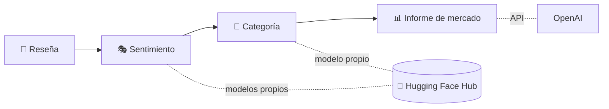
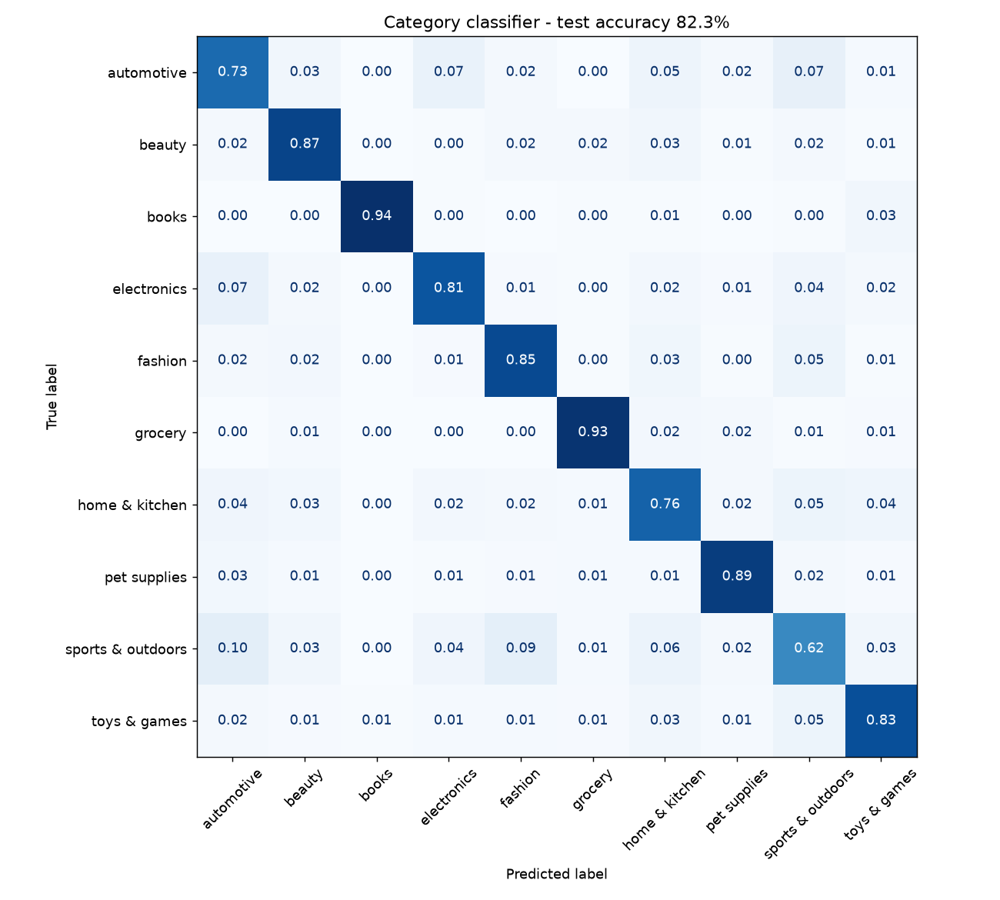

<div align="center">

# 🚀 Review Intelligence Dashboard

**Analiza reseñas de productos con modelos Transformer propios y genera informes de mercado con IA.**


[Qué hace](#-qué-hace) · [Puesta en marcha](#-puesta-en-marcha-en-3-pasos) · [Requisitos](#-requisitos-del-equipo) · [Modelos](#-modelos) · [Entrenamiento](#-entrenamiento-del-clasificador-de-categorías) · [Problemas comunes](#-problemas-comunes)

</div>

---

## ✨ Qué hace

| Módulo | Qué obtienes | ¿Necesita OpenAI? |
|---|---|:---:|
| 🎭 **Sentiment Classifier** | Sentimiento (positivo / neutral / negativo) con su confianza. Puedes comparar 3 modelos a la vez. | ❌ |
| 🎲 **Category Classifier** | Categoría de producto entre 10 clases (electronics, home & kitchen, books…), con un modelo entrenado en 70.000 reseñas de Amazon. | ❌ |
| 📝 **Research Post** | Búsqueda de mercado e informe tipo blog, generado en streaming y con citas. | ✅ |



- Los modelos **se descargan solos** de Hugging Face la primera vez que se usan y quedan en caché.
- Se cargan en memoria bajo demanda y se descargan de ella tras **180 s** sin uso.

---

## 🏁 Puesta en marcha en 3 pasos

> Solo necesitas **[Docker Desktop](https://www.docker.com/products/docker-desktop/)** abierto y **[Git](https://git-scm.com/downloads)**. No hace falta instalar Python ni descargar modelos a mano.

### 1️⃣ Clona el repositorio

```bash
git clone <url-del-repositorio>
cd project-amazon-review-classifier-nlp-ai
```

### 2️⃣ Construye y arranca

```bash
docker compose up --build -d
```

⏱️ El primer build tarda unos minutos (descarga Python, PyTorch y Transformers). Los siguientes arranques tardan segundos.

### 3️⃣ Abre el dashboard

👉 **http://localhost:8501**

Y listo. Sentiment y Category funcionan sin configurar nada más.

> ℹ️ La **primera** clasificación con cada modelo tarda un poco más, porque lo descarga de Hugging Face (entre 0,3 y 0,5 GB por modelo). Después queda guardado en un volumen de Docker y no se vuelve a descargar.

### ➕ Opcional: activar Research Post

Este módulo usa la API de OpenAI (es de pago). Crea `frontend/.env` a partir de la plantilla:

```bash
cp .env.example frontend/.env
```

Pon tu clave y reinicia:

```env
OPENAI_API_KEY=sk-...tu_clave...
```

```bash
docker compose up -d --force-recreate
```

> 🔒 `frontend/.env` está en `.gitignore` y no se copia a la imagen Docker. Sin él, la app arranca igual y Research Post muestra un aviso.

---

## 💻 Requisitos del equipo

| Recurso | Mínimo | Recomendado | Por qué |
|---|---|---|---|
| 🧠 **RAM** | 8 GB | 16 GB | Cada modelo ocupa ~0,5–1 GB en memoria. Comparar los 3 modelos de sentimiento a la vez pide unos 3–4 GB **solo para el contenedor**. |
| 💾 **Disco libre** | 6 GB | 10 GB | Imagen Docker ≈ 1,8 GB + modelos descargados ≈ 1,8 GB + caché de build. |
| ⚙️ **CPU** | 4 núcleos | 8 núcleos | La inferencia corre en CPU; una predicción tarda menos de un segundo con el modelo ya cargado. |
| 🎮 **GPU** | No necesaria | — | La app funciona solo con CPU. La GPU solo se usa si quieres reentrenar el modelo. |
| 🌐 **Internet** | Necesario | — | Para el primer build, la primera descarga de cada modelo y las llamadas a OpenAI. |

| Software | Notas |
|---|---|
| 🐳 Docker Desktop 4.x+ | En Windows, con el backend **WSL 2**. Incluye `docker compose`. |
| 🔧 Git | Para clonar el repositorio. |
| 🔑 Clave de OpenAI | **Opcional**, solo para Research Post. |

> ⚠️ **Windows:** Docker Desktop limita la RAM de WSL 2 (por defecto, la mitad de la del equipo). Con 8 GB, comprueba que Docker tenga al menos **5 GB**.

---

## 🧰 Comandos útiles

| Acción | Comando |
|---|---|
| ▶️ Arrancar (sin reconstruir) | `docker compose up -d` |
| 📜 Ver logs en directo | `docker logs -f ml-unified-intelligence` |
| ⏹️ Parar | `docker compose down` |
| 🔁 Reconstruir tras cambiar código | `docker compose up --build -d` |
| 🗑️ Borrar también los modelos descargados | `docker compose down -v` |
| 🧹 Liberar espacio de builds antiguos | `docker builder prune` |

---

## 🤖 Modelos

Todos los modelos propios están publicados en Hugging Face y se declaran en [`models/models.yaml`](models/models.yaml):

| Clave | Tarea | Modelo | Resultado en test |
|---|---|---|---|
| `lora_finetuned` | Sentimiento | [jramduran/review-sentiment-roberta-lora](https://huggingface.co/jramduran/review-sentiment-roberta-lora) · RoBERTa-base + LoRA (r=16) | 80,7 % accuracy · F1 macro 0,754 |
| `roberta_finetuned` | Sentimiento | [jramduran/review-sentiment-roberta-base](https://huggingface.co/jramduran/review-sentiment-roberta-base) · RoBERTa-base ajustado completo | — |
| `roberta_reference` | Sentimiento | [cardiffnlp/twitter-roberta-base-sentiment-latest](https://huggingface.co/cardiffnlp/twitter-roberta-base-sentiment-latest) · referencia pública para comparar | — |
| `category` | Categoría | [jramduran/review-category-distilroberta](https://huggingface.co/jramduran/review-category-distilroberta) · DistilRoBERTa, 10 clases | **82,3 % accuracy · F1 macro 0,823** |

**Cómo se resuelve cada modelo:**
1. Si existe una carpeta en `models/` cuyo nombre contiene el `keyword` del modelo, se usa esa copia local. Útil para probar un modelo recién entrenado.
2. Si no, se descarga del `hub_id` de Hugging Face.

---

## 🧪 Entrenamiento del clasificador de categorías

El código está en [`training/`](training/) y es reproducible de principio a fin.

| | |
|---|---|
| **Datos** | 70.000 reseñas de [Amazon Reviews 2023](https://huggingface.co/datasets/McAuley-Lab/Amazon-Reviews-2023), **7.000 por categoría** (título + texto, sin reseñas de menos de 8 palabras) |
| **División** | 80 % train · 10 % validación · 10 % test (estratificada) |
| **Modelo base** | `distilroberta-base` |
| **Entrenamiento** | 3 epochs · lr 3e-5 · batch 32 · max 128 tokens · fp16 |
| **Hardware** | NVIDIA RTX 5060 Laptop (8 GB) · **7,3 minutos** |
| **Resultado** | **82,3 % accuracy** · F1 macro 0,823 en test |

<p align="center">
  
</p>

**Lectura de resultados:**
- 🟢 Las categorías con vocabulario propio son casi perfectas: **books 96 %**, **grocery 92 %**, **pet supplies 89 %** (F1).
- 🟠 **sports & outdoors (64 %)** es la más difícil: se confunde con *fashion* (ropa deportiva) y con *automotive* (accesorios de exterior).
- Parte del error no se puede evitar: reseñas como "llegó rápido, buen vendedor" no dicen nada del producto.

**Reproducirlo** (requiere [uv](https://github.com/astral-sh/uv); con GPU NVIDIA tarda minutos, solo con CPU, horas):

```bash
cd training
uv sync                              # PyTorch con CUDA 12.8
uv run python prepare_data.py        # descarga y equilibra el dataset (~150 MB)
uv run python train_category.py      # entrena y guarda en models/category-distilroberta/
```

`train_category.py` deja el modelo en `models/`, así que la app lo usa automáticamente en lugar del de Hugging Face. Las métricas y la matriz de confusión se guardan en `training/reports/`.

---

## ⚙️ Configuración

| Variable | Por defecto | Descripción |
|---|---|---|
| `OPENAI_API_KEY` | — | Solo para Research Post (en `frontend/.env`). |
| `OPENAI_MODEL` | `gpt-4o-mini` | Modelo de OpenAI para los informes. |
| `MODEL_IDLE_SECONDS` | `180` | Segundos sin uso antes de liberar un modelo de memoria. |
| `MODEL_MANAGER_VERBOSE` | `true` | Logs detallados de la carga de modelos. |
| `MODEL_ROOT` | `/models` | Ruta de los modelos locales dentro del contenedor. |

---

## 🩺 Problemas comunes

<details>
<summary><b>❌ <code>Cannot connect to the Docker daemon</code></b></summary>

Docker Desktop no está abierto. Ábrelo, espera a que indique *Engine running* y repite el comando.
</details>

<details>
<summary><b>❌ <code>port is already allocated</code> (puerto 8501 ocupado)</b></summary>

Otro proceso usa el puerto 8501. Ciérralo, o cambia el mapeo en `docker-compose.yml` a `"8502:8501"` y entra por `http://localhost:8502`.
</details>

<details>
<summary><b>❌ La primera clasificación tarda mucho o falla</b></summary>

La primera vez se descarga el modelo desde Hugging Face. Comprueba tu conexión y mira el progreso con `docker logs -f ml-unified-intelligence`.
</details>

<details>
<summary><b>❌ El contenedor se reinicia o se cierra al clasificar</b></summary>

Casi siempre es falta de memoria. Sube la RAM asignada a Docker (*Settings → Resources*, o `.wslconfig` en Windows) o compara menos modelos a la vez.
</details>

<details>
<summary><b>❌ Research Post muestra "Operational Warning"</b></summary>

Falta la clave de OpenAI. Sigue [Activar Research Post](#-opcional-activar-research-post). Si la clave está puesta, comprueba que es correcta y que la cuenta tiene saldo.
</details>

---

## 🛠️ Desarrollo local (sin Docker)

Requiere Python 3.12 y [uv](https://github.com/astral-sh/uv).

```bash
cd frontend
uv sync
uv run streamlit run Home.py
```

---

## 📂 Estructura del proyecto

```text
.
├── docker-compose.yml        # Orquestación del servicio
├── .env.example              # Plantilla de variables de entorno
├── models/
│   └── models.yaml           # Registro de modelos (local o Hugging Face)
├── frontend/
│   ├── Dockerfile            # Build en dos etapas (uv + Python 3.12 slim, PyTorch CPU)
│   ├── Home.py               # Página de inicio
│   ├── pages/                # Sentiment · Category · Research
│   ├── logic/                # Gestión de modelos, OpenAI, estilos
│   └── pyproject.toml        # Dependencias de la app
└── training/
    ├── prepare_data.py       # Descarga y equilibra Amazon Reviews 2023
    ├── train_category.py     # Fine-tuning de DistilRoBERTa
    ├── upload_to_hub.py      # Publica los modelos en Hugging Face
    └── reports/              # Métricas y matriz de confusión
```
