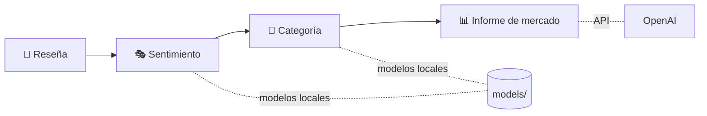

<div align="center">

# 🚀 Review Intelligence Dashboard

**Analiza reseñas de productos con modelos Transformer locales y genera informes de mercado con IA.**


[Qué hace](#-qué-hace) · [Requisitos](#-requisitos-del-equipo) · [Instalación](#-puesta-en-marcha-en-5-pasos) · [Modelos](#-modelos) · [Problemas comunes](#-problemas-comunes)

</div>

---

## ✨ Qué hace

| Módulo | Qué obtienes | ¿Necesita OpenAI? |
|---|---|:---:|
| 🎭 **Sentiment Classifier** | Sentimiento (positivo / neutral / negativo) y confianza. Puedes comparar varios modelos a la vez. | ❌ |
| 🎲 **Category Classifier** | Categoría de mercado de la reseña (electrónica, comida, moda…). | ❌ |
| 📝 **Research Post** | Búsqueda de mercado e informe tipo blog, generado en streaming y con citas. | ✅ |



Los modelos se cargan la primera vez que se usan y se descargan de memoria tras **180 s** sin uso, para no ocupar RAM de más.

---

## 💻 Requisitos del equipo

### Software

| Herramienta | Versión | Notas |
|---|---|---|
| 🐳 [Docker Desktop](https://www.docker.com/products/docker-desktop/) | 4.x o superior | En Windows, con el backend **WSL 2** activado. Incluye `docker compose`. |
| 🔧 [Git](https://git-scm.com/downloads) | cualquiera | Para clonar el repositorio. |
| 🔑 Clave de [OpenAI](https://platform.openai.com/api-keys) | — | Solo para el módulo *Research Post*. Requiere saldo en la cuenta. |

> 💡 No hace falta instalar Python: todo corre dentro del contenedor.

### Hardware

| Recurso | Mínimo | Recomendado | Por qué |
|---|---|---|---|
| 🧠 **RAM** | 8 GB | 16 GB | PyTorch y cada modelo RoBERTa ocupan ~1 GB en memoria. Comparar los 3 modelos a la vez pide unos 4 GB **solo para el contenedor**. |
| 💾 **Disco libre** | 15 GB | 20 GB | Imagen Docker ≈ 8,2 GB + modelos locales ≈ 0,6 GB + modelos descargados de Hugging Face ≈ 1 GB + caché de build. |
| ⚙️ **CPU** | 4 núcleos | 8 núcleos | La inferencia corre en CPU; una predicción tarda menos de un segundo con el modelo ya cargado. |
| 🎮 **GPU** | No necesaria | — | El proyecto funciona solo con CPU. |
| 🌐 **Internet** | Necesario | — | Para el primer build (~3–4 GB), la primera carga de modelos de Hugging Face y las llamadas a OpenAI. |

> ⚠️ **Windows:** Docker Desktop limita la RAM que puede usar WSL 2 (por defecto, la mitad de la del equipo). Si tienes 8 GB, comprueba que Docker tenga al menos **6 GB** disponibles.

---

## 🏁 Puesta en marcha en 5 pasos

### 1️⃣ Clona el repositorio

```bash
git clone <url-del-repositorio>
cd project-amazon-review-classifier-nlp-ai
```

### 2️⃣ Añade los modelos entrenados

Los pesos de los modelos **no están en el repositorio** (pesan demasiado para Git). Cópialos dentro de `models/` con esta estructura:

```text
models/
├── models.yaml                          ← ya incluido
├── sentiment-lora/                      ← adaptador LoRA
│   ├── experiment_config.json
│   └── final_model/
│       ├── adapter_config.json
│       ├── adapter_model.safetensors
│       ├── tokenizer.json
│       └── tokenizer_config.json
└── roberta-base-sentiment-finetuned/    ← modelo RoBERTa completo
    ├── config.json
    ├── model.safetensors
    ├── tokenizer.json
    └── tokenizer_config.json
```

> Sin estas carpetas la app arranca igual: el modelo de referencia `roberta_reference` (Hugging Face) y el clasificador de categorías siguen funcionando.

### 3️⃣ Configura tu clave de OpenAI

Crea el archivo `frontend/.env` a partir de la plantilla:

```bash
cp .env.example frontend/.env
```

Y rellénalo:

```env
OPENAI_API_KEY=sk-...tu_clave...
```

> 🔒 `frontend/.env` está en `.gitignore` y no se copia a la imagen Docker. Nunca subas tu clave al repositorio.

### 4️⃣ Construye y arranca

Con Docker Desktop abierto:

```bash
docker compose up --build -d
```

⏱️ El **primer build tarda 10–15 minutos** porque descarga PyTorch y Transformers. Los siguientes arranques tardan segundos.

### 5️⃣ Abre el dashboard

👉 **http://localhost:8501**

Para comprobar que el contenedor está sano:

```bash
docker ps                                   # STATUS debe mostrar "(healthy)"
curl http://localhost:8501/_stcore/health   # debe responder "ok"
```

> La **primera** clasificación con cada modelo tarda más: se carga en memoria y, si es de Hugging Face, se descarga.

---

## 🧰 Comandos útiles

| Acción | Comando |
|---|---|
| ▶️ Arrancar (sin reconstruir) | `docker compose up -d` |
| 📜 Ver logs en directo | `docker logs -f ml-unified-intelligence` |
| ⏹️ Parar | `docker compose down` |
| 🔁 Reconstruir tras cambiar código | `docker compose up --build -d` |
| 🧹 Liberar espacio de builds antiguos | `docker builder prune` |

---

## 🤖 Modelos

Los modelos se declaran en [`models/models.yaml`](models/models.yaml):

| Clave | Tipo | Origen | Descripción |
|---|---|---|---|
| `lora_finetuned` | LoRA (PEFT) | `models/sentiment-lora/` | Adaptador sobre `FacebookAI/roberta-base`. El modelo base se descarga de Hugging Face en el primer uso. |
| `roberta_finetuned` | Modelo completo | `models/roberta-base-sentiment-finetuned/` | RoBERTa-base ajustado para sentimiento. |
| `roberta_reference` | Hugging Face Hub | `cardiffnlp/twitter-roberta-base-sentiment-latest` | Modelo de referencia para comparar. |
| `category` | Pipeline | `models/*category*/` (opcional) | Si no hay modelo, usa una heurística por palabras clave. |

Para añadir un modelo nuevo, copia su carpeta en `models/` y añade una entrada en `models.yaml` con `type`, `keyword` (texto que contiene el nombre de la carpeta) y `task`.

---

## ⚙️ Configuración

Variables definidas en [`docker-compose.yml`](docker-compose.yml) y `frontend/.env`:

| Variable | Por defecto | Descripción |
|---|---|---|
| `OPENAI_API_KEY` | — | **Obligatoria** para *Research Post*. |
| `OPENAI_MODEL` | `gpt-4o-mini` | Modelo de OpenAI para los informes. |
| `MODEL_IDLE_SECONDS` | `180` | Segundos sin uso antes de descargar un modelo de memoria. |
| `MODEL_MANAGER_VERBOSE` | `true` | Logs detallados de la carga de modelos. |
| `MODEL_ROOT` | `/models` | Ruta de los modelos dentro del contenedor. |

---

## 🩺 Problemas comunes

<details>
<summary><b>❌ <code>Cannot connect to the Docker daemon</code></b></summary>

Docker Desktop no está abierto. Ábrelo, espera a que el icono indique *Engine running* y repite el comando.
</details>

<details>
<summary><b>❌ <code>port is already allocated</code> (puerto 8501 ocupado)</b></summary>

Otro proceso usa el puerto 8501. Ciérralo, o cambia el mapeo en `docker-compose.yml` a `"8502:8501"` y entra por `http://localhost:8502`.
</details>

<details>
<summary><b>❌ El build falla con <code>no space left on device</code></b></summary>

Libera espacio con `docker system prune` y comprueba que tienes al menos 15 GB libres.
</details>

<details>
<summary><b>❌ El contenedor se reinicia o se cierra al clasificar</b></summary>

Casi siempre es falta de memoria. Sube la RAM asignada a Docker (*Settings → Resources*, o `.wslconfig` en Windows) o compara menos modelos a la vez.
</details>

<details>
<summary><b>❌ <code>Sentiment model '...' failed to load</code></b></summary>

Faltan los archivos del modelo en `models/`, o la carpeta no coincide con el `keyword` de `models.yaml`. Revisa el [paso 2](#2️⃣-añade-los-modelos-entrenados) y los logs con `docker logs ml-unified-intelligence`.
</details>

<details>
<summary><b>❌ <i>Research Post</i> devuelve un error de autenticación</b></summary>

La clave de `frontend/.env` falta, es incorrecta o la cuenta no tiene saldo. Tras corregirla, reinicia con `docker compose up -d --force-recreate`.
</details>

---

## 🛠️ Desarrollo local (sin Docker)

Requiere Python 3.12 y [uv](https://github.com/astral-sh/uv).

```bash
cd frontend
uv sync
uv run streamlit run Home.py
```

---

## 📂 Estructura del proyecto

```text
.
├── docker-compose.yml        # Orquestación del servicio
├── .env.example              # Plantilla de variables de entorno
├── models/                   # Modelos locales + models.yaml
└── frontend/
    ├── Dockerfile            # Build en dos etapas (uv + Python 3.12 slim)
    ├── Home.py               # Página de inicio
    ├── pages/                # Sentiment · Category · Research
    ├── logic/                # Gestión de modelos, OpenAI, estilos
    └── pyproject.toml        # Dependencias
```
